# 瑞皮 Rapid · 爬宠摄像头产品需求文档

版本：V1.0 ｜ 日期：2026-10-26 ｜ 接入产品：亿田云 APP ｜ 接入方式：UniApp 原生插件

本需求用于将瑞皮 Rapid 爬宠摄像头接入亿田云 APP。摄像头作为设备列表中的一个新设备类型，提供视频直播和智能养护两类功能。

## 1. 产品范围与功能清单

### 1.1 使用场景与入口

亿田云是基于 UniApp 的多设备管理 APP。用户先进入亿田云设备列表，再点击已添加的爬宠摄像头，进入该设备的详情页。详情默认展示视频直播，可切换到智能养护；从详情返回设备列表。

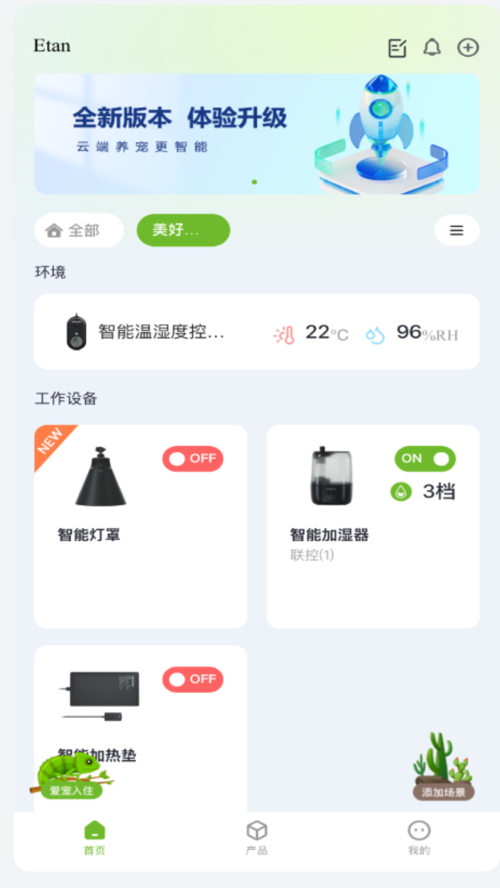

图：亿田云 APP 现有设备列表。爬宠摄像头作为新设备类型加入该列表，点击摄像头卡片后进入视频直播与智能养护。

接入方式为 UniApp 业务页面调用原生插件。原生插件提供视频播放、截图、录像及摄像头操作能力，APP 页面负责导航、数据展示和用户交互。本次不以独立 H5 页面作为产品入口。

本期仅包含爬宠摄像头功能，不包含中控屏、智慧中控、温湿度监测或外设控制，也不新增付费开通流程。

### 1.2 基础摄像头功能

| 编号 | 功能 | 功能内容 | 对应需求 |
|---|---|---|---|
| B01 | 设备列表入口 | 新设备类型、设备卡片、在线状态、进入详情及返回列表 | F01 |
| B02 | 摄像头切换 | 同账号摄像头列表、当前设备标记、会话与数据切换 | F02 |
| B03 | 视频直播 | 实时画面、在线状态、时间、离线与加载失败处理 | F03 |
| B04 | 全屏 | 原生播放器全屏观看、退出后恢复页面 | F04 |
| B05 | 截图 | 截取当前帧、保存设备相册、成功预览 | F05 |
| B06 | 手动录像 | 开始、结束、自动保存、录制时长 | F06 |
| B07 | 画质切换 | 高清 / 标清，按设备保存选择 | F07 |
| B08 | 本地回放 | 读取存储卡、容量展示、按日期选择录像 | F08 |
| B09 | 云回放 | 按设备和日期查看已有云录像 | F09 |
| B10 | 回放控制 | 播放 / 暂停、片段切换、四档倍速、失败重试 | F10 |
| B11 | 相册 | 截图与录像列表、详情查看、单条删除 | F11 |
| B12 | 隐私模式 | 停止 / 恢复视频采集，保留已有录像及报告 | F12 |

### 1.3 AI 智能养护功能

| 编号 | 功能 | 展示结果及操作 | 对应需求 |
|---|---|---|---|
| A01 | 养护总览 | 今日状态、健康评估；各指标独立判断数据是否可用 | F13 |
| A02 | 进食 / 饮水识别 | 最近一次时间、当日次数、AI 饮食分析、行为事件 | F14 |
| A03 | 活动识别 | 累计时长、活动次数、AI 活动分析、活动事件 | F15 |
| A04 | 活动区域分析 | 九宫格活跃度与区域描述 | F15 |
| A05 | 蜕皮检测 | 当前状态、上次蜕皮、平均周期、下次预计、历史时间线 | F16 |
| A06 | AI 状态解读 | 综合进食、饮水、活动记录生成说明和观察建议 | F17 |
| A07 | 多维健康评估 | 综合评分、昨日变化、近 7 日趋势、三类维度及参数分 | F18 |
| A08 | 风险识别与健康解读 | 外伤、皮肤溃烂风险结果及综合健康说明 | F19 |
| A09 | 历史日报查看 | 饮食、活动报告按日期查询；无报告时显示空态 | F20 |
| A10 | 事件片段 | 从行为事件打开对应视频，支持播放、暂停、拖动及重播 | F21 |

AI 识别按能力分别部署在摄像头端或云端，报告与解读由云端生成，具体见 1.5。APP 展示结果并提供对应事件片段入口；UniApp 页面及手机端原生插件不执行识别算法。识别结果缺失时显示“数据不足”，不使用示例结论补位。

### 1.4 配套能力及范围

| 功能 | 本期处理方式 |
|---|---|
| 宠物关联 | 摄像头关联单只爬宠，支持选择档案或新建；详见 F22 |
| 设备添加与绑定 | 复用亿田云设备添加流程；添加成功后，摄像头出现在设备列表中。本文不展开配网操作步骤 |
| 设备设置 | 复用设备名称、设备信息及解绑等宿主能力；关联宠物入口进入 F22 |
| 账号与设备归属 | 由亿田云提供当前账号和设备上下文；原生插件不建立另一套登录 |
| 摄像头功能角色 | 沿用当前文档的拥有者 / 共享成员规则，具体可操作项见 2.1 |

### 1.5 AI 算法能力

以下为摄像头识别与智能养护使用的算法能力。端侧指摄像头设备端，云端负责相应识别、推理和分析；亿田云 APP 展示结果并提供视频与报告入口。

| 类别 | 功能 | 功能说明 | 部署方式 |
|---|---|---|---|
| 品种识别 | 蜥蜴品种识别 | 识别蜥蜴品种，支持 19 种蜥蜴品类。 | 端侧 |
| 行为监测 | 运动识别 | 识别爬宠处于运动状态。 | 端侧 |
| 行为监测 | 静止识别 | 识别爬宠处于静止状态。 | 端侧 |
| 行为监测 | 行为热力图 | 将摄像头画面划分为九宫格，以热力图展示爬宠活动的空间分布。 | 端侧 |
| 饮食识别 | 进食识别 | 通过连续视频画面中的动作变化，识别爬宠是否正在进食。 | 初步云端部署 后续可通过 OTA 迁移至端侧 |
| 饮食识别 | 饮水识别 | 通过连续视频画面中的动作变化，识别爬宠是否正在饮水。 | 初步云端部署 后续可通过 OTA 迁移至端侧 |
| 蜕皮监测 | 蜕皮识别 | 识别爬宠蜕皮状态，区分未蜕皮与蜕皮中。 | 云端 |
| 蜕皮监测 | 卡皮识别 | 结合品种知识与蜕皮周期，推断爬宠是否存在疑似卡皮情况。 | 云端 |
| 健康评估 | 健康评分 | 利用大模型推理评估爬宠健康状态，生成健康评分。 | 云端 |
| 健康评估 | 异常疾病识别 | 识别皮肤溃烂、外伤等疑似异常迹象。 | 云端 |
| AI 快速解读 | AI 状态解读 | 基于识别数据与预设提示词，利用大模型生成爬宠状态解读。 | 云端 |
| AI 快速解读 | AI 健康解读 | 基于识别数据与预设提示词，利用大模型生成爬宠健康解读。 | 云端 |
| AI 专项分析 | AI 饮食分析 | 结合行为识别数据与品种饮食习性知识，分析爬宠饮食情况。 | 云端 |
| AI 专项分析 | AI 活动分析 | 结合行为识别数据与品种活动习性知识，分析爬宠活动情况。 | 云端 |
| AI 专项分析 | AI 蜕皮分析 | 结合行为识别数据与品种蜕皮习性知识，分析爬宠蜕皮情况。 | 云端 |
| 爬宠知识库 | 品种习性知识 | 提供各品种的饮食、活动及蜕皮习性知识。 | 云端 |
| 爬宠知识库 | 品种适宜环境知识 | 提供各品种适宜的冷区温度、热区温度及湿度区间。 | 云端 |

品种识别与知识库为识别、分析提供基础能力，不新增独立页面。品种适宜环境知识用于养护分析，不增加温湿度监测或外设控制功能。

**健康服务说明：** AI 健康分析仅用于辅助关注、风险分级和就医建议，不构成医疗诊断、处方或替代兽医建议。

## 2. 页面结构与统一规则

| 页面 | 入口 | 返回位置 |
|---|---|---|
| 亿田云设备列表 | 打开亿田云 APP | 沿用 APP 现有导航 |
| 摄像头详情 | 设备列表 → 点击爬宠摄像头卡片 | 亿田云设备列表 |
| 视频直播 / 智能养护 | 摄像头详情顶部切换栏 | 两个同级栏目相互切换 |
| 本地回放 / 云回放 | 视频直播功能卡 | 视频直播 |
| 相册及媒体详情 | 视频直播 / 截图成功提示 | 详情关闭回相册，相册返回直播 |
| 饮食 / 活动 / 蜕皮详情 | 智能养护对应详情按钮 | 智能养护 |
| 健康报告 | 智能养护健康报告按钮 | 智能养护 |
| 事件片段弹层 | 饮食 / 活动事件缩略图 | 当前报告与浏览位置 |
| 设备与宠物相关弹层 | 顶部名称 / 设置 / 关联引导 | 原页面 |

- 设备归属：画面、相册和报告均按设备读取。报告还需匹配宠物和日期。切换设备后清除原设备内容，再加载目标设备数据。
- 日期：最多选择当天，未来日期禁用。养护总览展示当天数据；饮食、活动和回放支持选日期；蜕皮和健康详情使用进入时的报告日期。
- 权限：拥有者可查看和管理设备，共享成员只读。具体权限见下表，页面和服务端均需校验。
- 数据状态：区分加载中、加载成功、无数据和加载失败。缺失或失败时显示对应提示，不填入 0 或正常结论。
- 返回：优先关闭当前弹层，其次返回上级页面，从摄像头详情返回亿田云设备列表；来源页面恢复滚动位置。
- 操作反馈：普通提示显示 2.5 秒。读取失败保留重试入口；操作成功后同步更新卡片、数量和状态。
- 图表：九宫格、健康趋势、雷达图和蜕皮时间线均为只读，无编辑或点击查看明细功能。

### 2.1 功能权限

以下权限均以账号已获得该设备访问权为前提。

| 功能 | 拥有者 | 共享成员 | 离线 | 隐私开启 |
|---|---|---|---|---|
| 直播 / 全屏 | 可 | 可 | 不可 | 不可 |
| 截图 / 手动录像 | 可 | 不可 | 不可 | 不可 |
| 切换画质 | 可 | 不可 | 不可 | 不可 |
| 修改隐私状态 | 可 | 不可 | 不可 | 在线拥有者可关闭 |
| 本地回放 | 可 | 可 | 不可 | 在线且有卡可看已有录像 |
| 云回放 | 可 | 可 | 可看已有云录像 | 可看已有云录像 |
| 相册查看 | 可 | 可 | 可 | 可 |
| 相册删除 | 可 | 不可 | 可 | 可 |
| 真实养护结果 | 已关联宠物档案可看 | 已关联宠物档案可看 | 可看已有结果 | 可看已有结果 |
| 关联宠物 | 可 | 不可 | 可 | 可 |

## 3. 视频直播功能

### F01 进入摄像头与栏目切换

**入口：** 亿田云 APP → 设备列表 → 爬宠摄像头卡片。

**交互规则**

- 亿田云设备列表新增“爬宠摄像头”设备类型。卡片展示设备名称、类型图标和在线状态；多台摄像头分别展示，其他设备类型保持原有入口。
- 点击卡片后，APP 传入所选设备标识并打开摄像头详情，初始化原生插件会话。初始化期间显示加载状态，失败时显示“设备连接失败”并提供重试和返回。重复点击不重复打开详情或创建会话。
- 详情默认选中“视频直播”，顶部展示设备名称、关联宠物、角色和设置入口；栏目仅包含“视频直播”“智能养护”。离线设备仍可进入详情，按各功能规则展示可用内容。
- 切换栏目保留当前设备，内容滚动至顶部；正在录制时先结束录像并存入原设备相册，再切换栏目。
- 详情子页返回上一级并恢复滚动位置，弹层关闭后回到触发页面。从摄像头详情返回时结束录像、关闭播放器并释放插件会话，回到亿田云设备列表，保留原列表位置。

**操作流程**

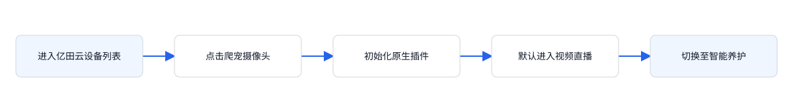

**验收标准：** 打开亿田云 APP 不直接进入摄像头；点击所选摄像头卡片后进入对应设备的直播页。初始化失败可重试；返回时恢复设备列表位置，录像已保存且播放器停止。

### F02 切换摄像头

**入口：** 点击页面顶部设备名称。

**交互规则**

- 打开摄像头列表，仅展示亿田云当前账号设备列表中的爬宠摄像头，其他类型设备不参与切换。每项展示名称、关联宠物和在线状态，标记当前设备。
- 选择设备后关闭弹层，切换到目标设备的“视频直播”，日期重置为当天，页面回到顶部。
- 切换前结束并保存正在录制的视频至原设备相册，清除原截图提示。随后加载目标设备的隐私、画质、媒体和报告。先结束原设备的插件播放会话，再连接目标设备；原设备请求的返回结果只更新原设备数据。

**操作流程**

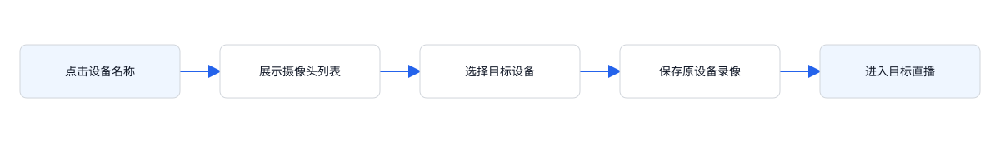

**验收标准：** A 设备录制时切换 B，录像归 A；B 展示自己的设备状态和报告。

### F03 视频直播与状态展示

**入口：** 进入“视频直播”栏目。

**交互规则**

- 在线且隐私关闭时显示实时画面、在线标识、当前画质与画面时间；默认画质为高清。录制时叠加“录像中”。
- 设备离线时显示“设备已离线”和最后在线时间；原视频画面替换为离线提示。
- 隐私开启时显示“隐私模式已开启 / 实时画面与实时操作已暂停”。同时离线与隐私开启时优先显示隐私遮罩。
- 离线或隐私开启均禁止全屏、截图、录像、画质操作。在线的拥有者可在隐私遮罩中关闭隐私模式。
- 直播加载中显示加载态；拉流失败显示重试入口，重试前重新检查在线与隐私状态。

**操作流程**

**验收标准：** 在线、离线、隐私三个状态展示对应内容；离线和隐私开启时，实时操作按钮均禁用。

### F04 全屏观看

**入口：** 直播工具栏 → 全屏。

**交互规则**

- 在线且隐私关闭时，拥有者和共享成员均可打开全屏画面。
- 全屏展示同一设备的视频，关闭后回到原直播页面；全屏开关不切换设备或修改画质。
- 进入全屏不结束正在进行的录像；全屏由原生播放器处理，退出后恢复详情页方向与布局。

**操作流程**

**验收标准：** 全屏前后设备一致；关闭全屏后原直播页面可继续操作。

### F05 直播截图

**入口：** 直播工具栏 → 截图。

**交互规则**

- 仅拥有者可操作，且设备在线、隐私关闭。点击后截取当前视频帧，新增一条当前设备的截图记录，按最新在前排列。
- 保存成功后在播放器区域显示截图预览、“截图已保存到相册”及“进入相册”按钮；相册数量同步增加。
- 跳转页面、切换设备、切换栏目或改变隐私状态后清除截图提示。截图保存目标为本功能内的设备相册。
- 保存失败展示失败提示且不增加成功记录；重复点击分别生成独立截图。

**操作流程**

**验收标准：** 截图后相册新增一项，提示可直达相册；共享成员、设备离线或隐私开启时，截图按钮禁用。

### F06 手动录像及自动结束

**入口：** 直播工具栏 → 录像。

**交互规则**

- 仅拥有者在在线、隐私关闭时可开始；开始后按钮变为“结束录像”，画面出现录像中标识。
- 再次点击结束录像，保存至开始录制设备的相册，记录类型、时间和时长；时长按秒四舍五入，最少显示 1 秒。
- 切换栏目、切换设备、离开摄像头页面、返回上一级或操作隐私模式时自动结束并保存。全屏及画质弹层不触发结束。
- 同一会话仅允许一段手动录像；保存完成后清除录制状态，相册按最新在前更新。
- 视频中断或退出页面时，结束录像并保存已录制的内容。保存失败时提示失败，相册不新增记录。

**操作流程**

**验收标准：** 手动结束与页面切换均可保存；设备切换后的录像归属不变，时长不小于 1 秒。

### F07 切换画质

**入口：** 直播工具栏 → 画质。

**交互规则**

- 仅在线、隐私关闭的拥有者可打开画质浮层；提供“高清、标清”两项并标记当前选择。
- 选择后关闭浮层并刷新播放器画质标识。画质按设备保存，其他摄像头不受影响。
- 再次点击画质、点击浮层外或按返回关闭浮层，未选择时保留原画质。

**操作流程**

**验收标准：** 切换至标清后标识与播放档位一致；再次打开选中标清。

### F08 本地回放

**入口：** 视频直播 → 本地回放。

**交互规则**

- 本地回放页只展示当前设备的存储卡录像，无需关联宠物。
- 先检查在线状态，再检查存储卡：离线显示“设备离线，无法读取存储卡”；在线但无卡显示“未检测到存储卡”。
- 读取成功后展示存储卡已用容量、总容量、日期和录像。容量格式为“已用 / 总容量”，例如“42.6 / 128 GB”。
- 默认日期为当天；仅允许选择当天及以前日期。按日拉取片段，有录像进入播放控制，无录像展示空态。

**操作流程**

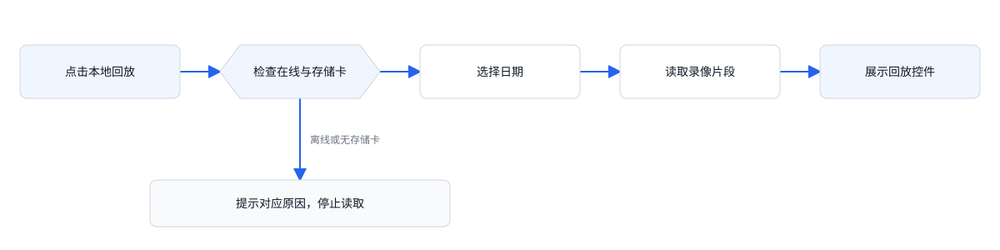

**验收标准：** 未关联宠物仍可播放本地录像；离线和无卡有不同提示，不能播放。

### F09 云回放

**入口：** 视频直播 → 云回放。

**交互规则**

- 进入独立云回放页，无需存储卡，设备当前离线也可查看已存在的云录像。
- 默认查看当天云录像，未来日期禁用；有片段进入播放控制，无录像显示当天无录像。
- 隐私模式不阻止查看已有云录像；隐私期间不新增实时采集内容。

**操作流程**

**验收标准：** 云录像按设备归属；离线设备也可查看已有云录像。

### F10 回放播放、倍速与异常恢复

**入口：** 本地回放或云回放页面。

**交互规则**

- 进入页面默认暂停；点击播放 / 暂停切换状态。点击可播放时段后切换至该时段并立即播放。
- 倍速每次点击按 1.0× → 1.5× → 2.0× → 0.5× → 1.0× 循环；当前选择在回放操作中保持。
- 切换日期清除已选时段并暂停，重新加载当天片段；新日期加载完成后，由用户重新选择片段。
- 无录像时显示“当天没有录像”及日期，禁用播放和倍速，不展示可点击片段。
- 加载失败显示“录像加载失败”与“重新加载”；重试当前来源及日期，成功回到可播放状态，失败继续保留重试。

**操作流程**

**验收标准：** 片段点击后播放；换日暂停；倍速循环完整；无录像或加载失败时不能播放。

### F11 相册查看与删除

**入口：** 视频直播 → 相册，或截图成功提示 → 进入相册。

**交互规则**

- 相册只展示当前设备的截图、录像；展示总数量，列表按新到旧排列。每项含预览图、类型、时间，录像额外显示秒数。
- 空相册提示“相册还是空的”，引导在直播中截图或录制。离线或隐私不影响已有媒体浏览。
- 点击记录打开详情：截图可看图片，录像可播放保存的视频；关闭详情返回相册。
- 拥有者详情提供“删除此记录”，点击立即删除并关闭详情，更新数量；共享成员没有删除入口。删除最后一项后显示空态。
- 删除失败保留原记录并提示失败；记录已不存在时展示“记录不存在”。

**操作流程**

**验收标准：** 截图和录像均可打开；拥有者删除后列表同步减少；共享成员只可查看。

### F12 隐私模式

**入口：** 视频直播 → 隐私模式；或隐私遮罩 → 关闭隐私模式。

**交互规则**

- 仅设备在线的拥有者可修改；共享成员与离线设备禁止修改。按钮显示“已开启 / 已关闭”。
- 点击切换开关，无二次确认；先结束并保存正在录制的视频，再应用隐私状态。
- 开启后停止实时采集、隐藏实时画面，禁用全屏、截图、录像与画质；关闭后恢复直播。
- 隐私开关按设备生效，已有相册、本地录像、云录像、历史分析保持可查看；停止新增视频和相应分析数据，历史结果保留原生成时间。
- 设备执行成功后更新开关；失败保持原状态并显示失败提示。

**操作流程**

**验收标准：** 开启隐私不丢失手动录像；遮罩和按钮一致；共享成员不能关闭隐私。

## 4. 智能养护功能

### F13 智能养护总览与数据状态

**入口：** 摄像头 → 智能养护。

**交互规则**

- 优先检查关联宠物。未关联时仅显示“先关联你的爬宠”，说明直播和回放可正常使用；拥有者可关联，共享成员不可操作。
- 已关联时，按当前设备、当前关联宠物、当天日期读取报告。总览分为“今日状态”和“健康评估”。
- 今日状态依次包含饮食分析、活动分析及九宫格、蜕皮检测、AI 状态解读；健康评估依次包含 AI 多维健康分析、异常疾病风险识别、AI 健康解读。
- 进食、饮水、活动、区域、蜕皮、健康、风险分别判断可用性。缺失或生成中显示“数据不足”与“—”，不使用 0 或正常状态代替。
- 饮食详情在进食或饮水至少一项可用时开放；活动、蜕皮、健康详情分别在本项可用时开放。某一项数据不足不影响其他项展示。
- 设备离线或开启隐私后，已生成的结果仍可查看；当天无数据时显示“数据不足”。

**操作流程**

**验收标准：** 未关联优先出现关联引导；部分结果可用时仅相应入口开放。

### F14 饮食分析与详情

**入口：** 智能养护 → 饮食分析 → 查看详情。

**交互规则**

- 总览分别展示最近一次进食、饮水时间；缺失的一项显示“— / 数据不足”。
- 详情包含周日期条、日历、进食与饮水统计、AI 饮食分析、事件记录。统计展示最近一次时间和当日次数。
- 事件展示日期、时间、行为类型、宠物相关描述及缩略图；点击缩略图打开对应事件视频片段。
- 仅一项可用时仍允许进入详情；不可用项不显示次数或对应事件，移除“表现正常”，综合结论显示“记录尚不完整，暂无法形成综合饮食结论”。
- 两项均不足时关闭详情入口；事件、次数、习性与结论始终归属当前报告宠物及所选日期。

**操作流程**

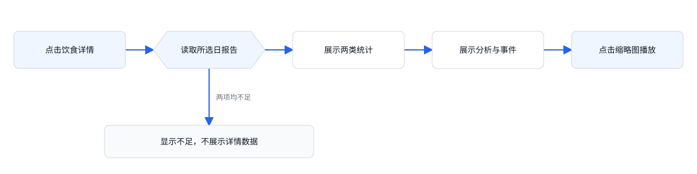

**验收标准：** 进食可用、饮水不足时只显示进食事件，不能出现完整饮食正常结论。

### F15 活动分析与活动区域

**入口：** 智能养护 → 活动分析 → 查看详情。

**交互规则**

- 总览显示当天累计活动时长，按小时与分钟表达；不足显示“—”，0 分钟属于有效统计值。
- 活动区域以九宫格展示相对活跃度并配文字结论；文字说明与当前九宫格数据保持一致。区域数据不足时使用中性九宫格并显示“活动区域数据不足”。
- 活动时长与区域数据相互独立：区域不足不屏蔽已存在的活动时长或活动详情。九宫格为只读展示，不增加区域编辑。
- 活动详情展示周日期条、日历、累计时长、活动次数、AI 活动分析及事件列表；事件缩略图可播放片段。

**操作流程**

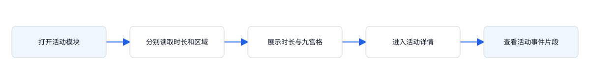

**验收标准：** 活动可用且区域不足时仍能查看活动详情，九宫格不显示虚假的热度。

### F16 蜕皮检测与周期记录

**入口：** 智能养护 → 蜕皮检测 → 查看详情。

**交互规则**

- 总览展示蜕皮识别状态与说明；未识别到蜕皮时显示“未蜕皮 / 未检测到蜕皮行为”。数据不足时显示“— / 数据不足，暂无法判断蜕皮状态”。
- 详情包含蜕皮状态、上次蜕皮距今天数、平均周期、下次预计日期、AI 蜕皮分析与历史周期时间线。
- 时间线展示每次开始、完成、持续时间、与相邻周期的间隔，并突出下次预计节点。
- 该详情不提供饮食/活动的周日期条与日历，也不添加事件视频缩略图。数据不足时禁止进入详情。
- 周期数值和解读使用当前宠物的蜕皮记录。无记录时按数据不足处理，不能显示“未蜕皮”。

**操作流程**

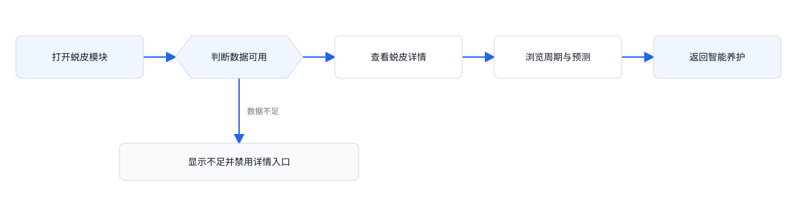

**验收标准：** 有数据时可进入周期详情；数据不足时禁用详情入口，并显示不足提示。

### F17 AI 状态解读

**入口：** 智能养护 → 今日状态底部。

**交互规则**

- 进食、饮水、活动三项均可用时显示对当前宠物的综合状态说明与日常观察建议。
- 任意一项不足时显示“进食、饮水或活动记录不足，暂无法形成完整的综合结论。”，不能沿用完整状态结论。
- 该模块只读，无独立详情入口。切换设备后更新宠物名称及解读内容。

**操作流程**

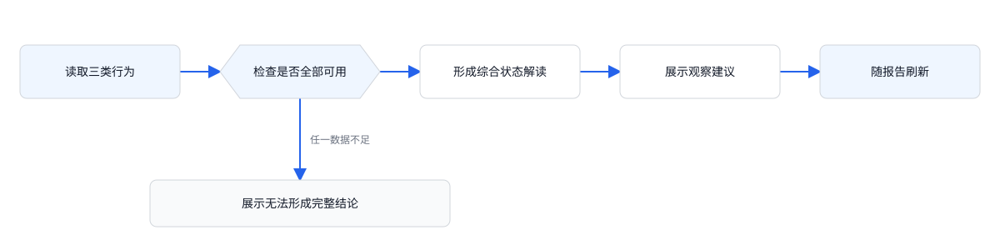

**验收标准：** 仅活动可用也不能输出三项完整综合结论；切换设备后不沿用原宠物名字。

### F18 多维健康分析与健康报告

**入口：** 智能养护 → AI 多维健康分析 → 查看健康报告。

**交互规则**

- 总览展示健康等级、分数与状态说明；可用时开放“查看健康报告”，不足时显示“数据不足 / —”并禁用入口。
- 详情展示综合评分、较昨日变化、近 7 日趋势、疾病风险识别及健康维度。
- 健康维度分为三项：活力指数（活动时长、活动频次、昼夜规律）；进食规律（进食频次、进食间隔、进食稳定）；体态健康（体表健康、姿态健康、健康稳定）。每项展示维度分及三个参数评分。
- 健康可用但风险不足时，健康详情继续展示评分与维度，仅风险区域显示“数据不足，暂无法判断风险”。
- 健康报告没有单独日期选择器，沿用进入时的报告。

**操作流程**

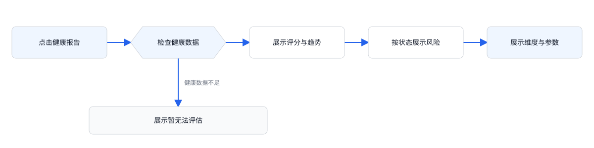

**验收标准：** 健康可用而风险不足时可进入详情，风险区域不显示正常结论。

### F19 异常疾病风险识别与 AI 健康解读

**入口：** 智能养护 → 健康评估区域及健康报告。

**交互规则**

- 风险数据可用时展示识别结果和观察建议；无明显风险时显示“暂未识别到明显风险”。风险不足时显示不足，不展示正常状态图标。
- 健康报告风险部分展示外伤、皮肤溃烂两类识别项及各自结果，并保留“识别结果仅供参考，不代表专业医学诊断”。
- AI 健康解读只有健康与风险均可用时才输出完整结论；任意一项不足则显示“健康或风险识别数据不足，暂无法生成完整健康解读。”
- 总览中的风险结果和 AI 解读只读，无独立操作入口。

**操作流程**

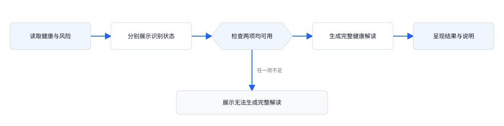

**验收标准：** 风险缺失时不展示“未识别到风险”；仅有健康分数时，不生成完整健康解读。

### F20 饮食 / 活动详情日期切换

**入口：** 饮食或活动详情 → 周日期条或日历。

**交互规则**

- 默认选择进入时报告日期，周日期条按周一至周日展示该日期所在周，日历可跨周选择。
- 仅允许当天及过去日期，未来日期禁用；切换后保留当前分析类型，滚动回顶部并重新读取报告。
- 查询必须同时匹配设备、报告所属宠物、所选日期。更换关联宠物不改写历史报告的宠物归属。
- 无当日报告显示“当天暂无报告 / 当前日期数据不足，可选择其他日期”，保留日期条以便继续选择。

**操作流程**

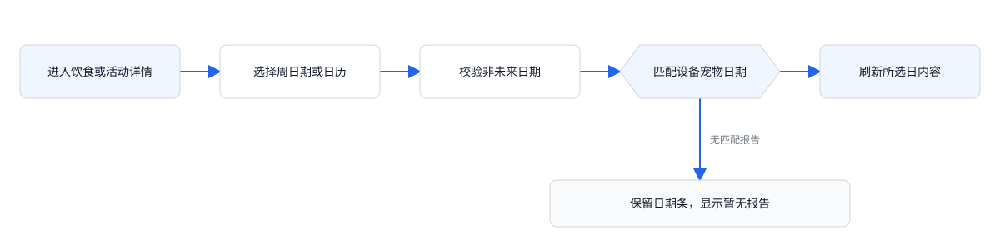

**验收标准：** 可跨周选历史日期；未来不可选；无报告后可切回有报告日期恢复内容。

### F21 行为事件视频片段

**入口：** 饮食或活动详情 → 事件缩略图播放按钮。

**交互规则**

- 打开事件视频弹层并从 0 秒自动播放；弹层绑定事件标题、宠物、日期、时间及设备。
- 提供暂停 / 播放、进度拖动、已播 / 总时长和关闭按钮；单个事件片段时长为 15 秒。
- 播放至结尾暂停，按钮变为“重播”；点击重播从 0 秒开始。拖动到末尾同样进入结束状态。
- 关闭弹层停止播放并释放资源，回到原报告和滚动位置。
- 片段加载失败时显示失败提示和重试按钮，播放器保持未播放状态。

**操作流程**

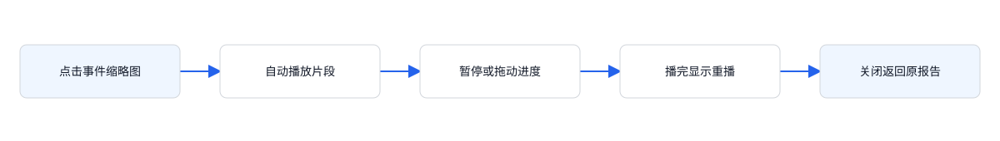

**验收标准：** 自动播放、暂停、拖动、结束重播和关闭均可完成；关闭后不继续计时或播放声音。

## 5. 宠物关联

### F22 关联宠物与新建档案

**入口：** 未关联养护引导，或设备设置 → 关联宠物。

**交互规则**

- 一台摄像头关联一只爬宠，关联弹层展示可选档案；拥有者可选择现有宠物或新建档案，共享成员只读。
- 选择不同宠物后保存关联，设备分析状态切为数据不足；新的分析使用新宠物档案，历史报告保留生成时宠物。
- 新建档案包含宠物名字、物种，均必填且去除首尾空格；名字最多 20 字符，物种最多 30 字符。
- 从关联弹层新建并保存后直接关联新宠物，关闭弹层并刷新页面；选择当前已关联宠物时，保留现有分析状态。

**操作流程**

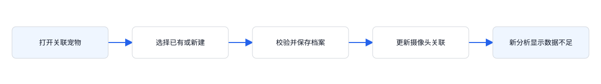

**验收标准：** 切换宠物后不会显示旧宠物当天结论；历史报告归属不变；空白字段不能保存。
