# 爬宠摄像头 H5 产品需求文档

版本：V1.0 ｜ 日期：2026-10-26

本文用于爬宠摄像头 H5 的开发和测试，包含页面结构、功能规则、权限、异常处理及验收场景。页面样式按 UI 设计稿实现。

## 1. 需求范围

在 APP 内通过 H5 提供爬宠摄像头功能，分为三个栏目：视频直播用于观看和保存影像；智能养护用于查看行为记录与健康报告；智慧中控用于查看温湿度和控制外设开关。

| 范围 | 本期内容 |
|---|---|
| 核心栏目 | 视频直播、智能养护、智慧中控（三个同级栏目） |
| 视频直播 | 实时画面、全屏、截图、录像、画质、本地回放、云回放、相册、隐私 |
| 智能养护 | 饮食、活动与区域、蜕皮、状态解读、健康报告、风险识别、健康解读 |
| 智慧中控 | 当前温度、当前湿度、关联外设列表、单设备开关及执行反馈 |

## 2. 页面结构与统一规则

| 页面 | 入口 | 返回位置 |
|---|---|---|
| 视频直播 / 智能养护 / 智慧中控 | 主页顶部切换栏 | 三个同级栏目相互切换 |
| 本地回放 / 云回放 | 视频直播功能卡 | 视频直播 |
| 相册及媒体详情 | 视频直播 / 截图成功提示 | 详情关闭回相册，相册返回直播 |
| 饮食 / 活动 / 蜕皮详情 | 智能养护对应详情按钮 | 智能养护 |
| 健康报告 | 智能养护健康报告按钮 | 智能养护 |
| 事件片段弹层 | 饮食 / 活动事件缩略图 | 当前报告与浏览位置 |
| 设备与宠物相关弹层 | 顶部名称 / 设置 / 关联引导 | 原页面 |

- 设备归属：画面、相册、报告、温湿度及外设均按设备读取。报告还需匹配宠物和日期。切换设备后清除原设备内容，再加载目标设备数据。
- 日期：最多选择当天，未来日期禁用。养护总览展示当天数据；饮食、活动和回放支持选日期；蜕皮和健康详情使用进入时的报告日期。
- 权限：拥有者可查看和管理设备，共享成员只读。具体权限见下表，页面和服务端均需校验。
- 数据状态：区分加载中、加载成功、无数据和加载失败。缺失或失败时显示对应提示，不填入 0 或正常结论。
- 返回：优先关闭当前弹层，其次返回上级页面，最后退出 H5；原页面恢复滚动位置。
- 操作反馈：普通提示显示 2.5 秒。读取失败保留重试入口；操作成功后同步更新卡片、数量和状态。
- 图表：九宫格、健康趋势、雷达图和蜕皮时间线均为只读，无编辑或点击查看明细功能。

### 2.1 功能权限

以下权限均以账号已获得该设备访问权为前提。

| 功能 | 拥有者 | 共享成员 | 离线 | 隐私开启 |
|---|---|---|---|---|
| 直播 / 全屏 | 可 | 可 | 不可 | 不可 |
| 截图 / 手动录像 | 可 | 不可 | 不可 | 不可 |
| 切换画质 | 可 | 不可 | 不可 | 不可 |
| 修改隐私状态 | 可 | 不可 | 不可 | 在线拥有者可关闭 |
| 本地回放 | 可 | 可 | 不可 | 在线且有卡可看已有录像 |
| 云回放 | 可 | 可 | 可看已有云录像 | 可看已有云录像 |
| 相册查看 | 可 | 可 | 可 | 可 |
| 相册删除 | 可 | 不可 | 可 | 可 |
| 真实养护结果 | 已关联宠物档案可看 | 已关联宠物档案可看 | 可看已有结果 | 可看已有结果 |
| 关联宠物 | 可 | 不可 | 可 | 可 |
| 温湿度与外设状态查看 | 可 | 可 | 仅历史值并标记失效 | 可，环境采集不受视频隐私影响 |
| 外设开关控制 | 在线且状态已同步可操作 | 不可 | 不可 | 控制链路在线可操作 |

## 3. 视频直播功能

### F01 进入摄像头与栏目切换

**入口：** H5 默认打开后的页面。

**交互规则**

- 进入 H5 后默认选中“视频直播”，展示设备名称、关联宠物、角色及设置入口；顶部切换栏依次为“视频直播”“智能养护”“智慧中控”，三者同级。
- 切换栏目保留当前设备，内容滚动至顶部；正在录制时先结束录像并存入原设备相册，再切换栏目。
- 详情页返回上一级并恢复原页面滚动位置；弹层关闭后回到触发页面。退出 H5 返回 APP 来源页。
- 智慧中控在同一顶部切换栏进入，不新建底部一级导航；切换后展示当前摄像头对应爬宠箱的温湿度与外设。

**操作流程**

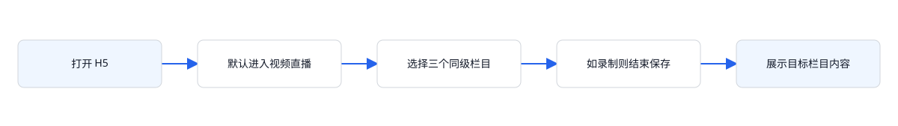

**验收标准：** H5 打开后默认展示视频直播；切换栏目保留当前设备；详情返回后恢复来源页及滚动位置。

### F02 切换摄像头

**入口：** 点击页面顶部设备名称。

**交互规则**

- 打开摄像头列表，展示每台摄像头名称、关联宠物、在线状态，标记当前设备。
- 选择设备后关闭弹层，切换到目标设备的“视频直播”，日期重置为当天，页面回到顶部。
- 切换前结束并保存正在录制的视频至原设备相册，清除原截图提示。随后加载目标设备的隐私、画质、媒体、报告和中控数据。原设备指令返回的结果只更新原设备状态。

**操作流程**

**验收标准：** A 设备录制时切换 B，录像归 A；B 展示自己的设备状态和报告。

### F03 视频直播与状态展示

**入口：** 进入“视频直播”栏目。

**交互规则**

- 在线且隐私关闭时显示实时画面、在线标识、当前画质与画面时间；默认画质为高清。录制时叠加“录像中”。
- 设备离线时显示“设备已离线”和最后在线时间；原视频画面替换为离线提示。
- 隐私开启时显示“隐私模式已开启 / 实时画面与实时操作已暂停”。同时离线与隐私开启时优先显示隐私遮罩。
- 离线或隐私开启均禁止全屏、截图、录像、画质操作。在线的拥有者可在隐私遮罩中关闭隐私模式。
- 直播加载中显示加载态；拉流失败显示重试入口，重试前重新检查在线与隐私状态。

**操作流程**

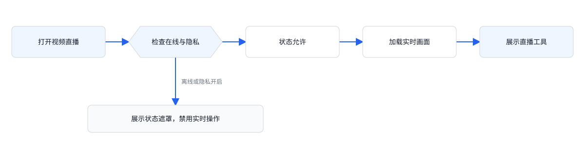

**验收标准：** 在线、离线、隐私三个状态展示对应内容；离线和隐私开启时，实时操作按钮均禁用。

### F04 全屏观看

**入口：** 直播工具栏 → 全屏。

**交互规则**

- 在线且隐私关闭时，拥有者和共享成员均可打开全屏画面。
- 全屏展示同一设备的视频，关闭后回到原直播页面；全屏开关不切换设备或修改画质。
- 进入全屏不结束正在进行的录像；全屏不可用时采用页面内铺满播放器，保留退出入口。

**操作流程**

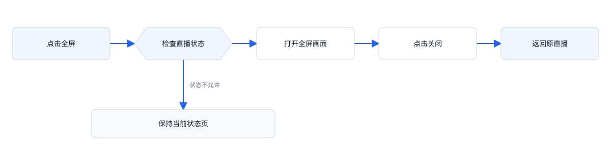

**验收标准：** 全屏前后设备一致；关闭全屏后原直播页面可继续操作。

### F05 直播截图

**入口：** 直播工具栏 → 截图。

**交互规则**

- 仅拥有者可操作，且设备在线、隐私关闭。点击后截取当前视频帧，新增一条当前设备的截图记录，按最新在前排列。
- 保存成功后在播放器区域显示截图预览、“截图已保存到相册”及“进入相册”按钮；相册数量同步增加。
- 跳转页面、切换设备、切换栏目或改变隐私状态后清除截图提示。截图保存目标为本功能内的设备相册。
- 保存失败展示失败提示且不增加成功记录；重复点击分别生成独立截图。

**操作流程**

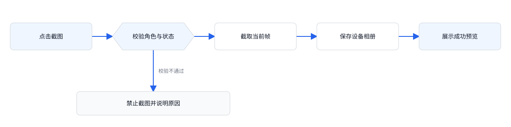

**验收标准：** 截图后相册新增一项，提示可直达相册；共享成员、设备离线或隐私开启时，截图按钮禁用。

### F06 手动录像及自动结束

**入口：** 直播工具栏 → 录像。

**交互规则**

- 仅拥有者在在线、隐私关闭时可开始；开始后按钮变为“结束录像”，画面出现录像中标识。
- 再次点击结束录像，保存至开始录制设备的相册，记录类型、时间和时长；时长按秒四舍五入，最少显示 1 秒。
- 切换栏目、切换设备、离开摄像头页面、返回上一级或操作隐私模式时自动结束并保存。全屏及画质弹层不触发结束。
- 同一会话仅允许一段手动录像；保存完成后清除录制状态，相册按最新在前更新。
- 视频中断或退出页面时，结束录像并保存已录制的内容。保存失败时提示失败，相册不新增记录。

**操作流程**

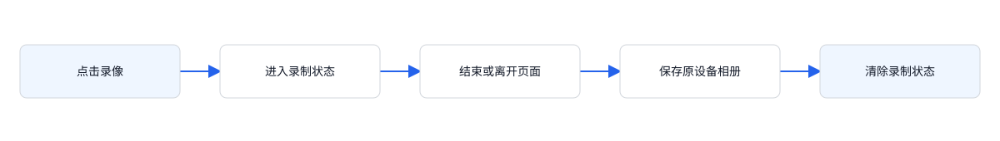

**验收标准：** 手动结束与页面切换均可保存；设备切换后的录像归属不变，时长不小于 1 秒。

### F07 切换画质

**入口：** 直播工具栏 → 画质。

**交互规则**

- 仅在线、隐私关闭的拥有者可打开画质浮层；提供“高清、标清”两项并标记当前选择。
- 选择后关闭浮层并刷新播放器画质标识。画质按设备保存，其他摄像头不受影响。
- 再次点击画质、点击浮层外或按返回关闭浮层，未选择时保留原画质。

**操作流程**

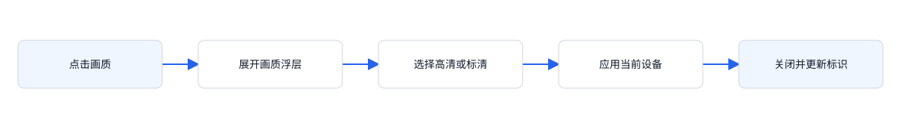

**验收标准：** 切换至标清后标识与播放档位一致；再次打开选中标清。

### F08 本地回放

**入口：** 视频直播 → 本地回放。

**交互规则**

- 本地回放页只展示当前设备的存储卡录像，无需关联宠物。
- 先检查在线状态，再检查存储卡：离线显示“设备离线，无法读取存储卡”；在线但无卡显示“未检测到存储卡”。
- 读取成功后展示存储卡已用容量、总容量、日期和录像。容量格式为“已用 / 总容量”，例如“42.6 / 128 GB”。
- 默认日期为当天；仅允许选择当天及以前日期。按日拉取片段，有录像进入播放控制，无录像展示空态。

**操作流程**

**验收标准：** 未关联宠物仍可播放本地录像；离线和无卡有不同提示，不能播放。

### F09 云回放

**入口：** 视频直播 → 云回放。

**交互规则**

- 进入独立云回放页，无需存储卡，设备当前离线也可查看已存在的云录像。
- 默认查看当天云录像，未来日期禁用；有片段进入播放控制，无录像显示当天无录像。
- 隐私模式不阻止查看已有云录像；隐私期间不新增实时采集内容。

**操作流程**

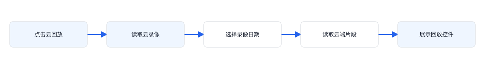

**验收标准：** 云录像按设备归属；离线设备也可查看已有云录像。

### F10 回放播放、倍速与异常恢复

**入口：** 本地回放或云回放页面。

**交互规则**

- 进入页面默认暂停；点击播放 / 暂停切换状态。点击可播放时段后切换至该时段并立即播放。
- 倍速每次点击按 1.0× → 1.5× → 2.0× → 0.5× → 1.0× 循环；当前选择在回放操作中保持。
- 切换日期清除已选时段并暂停，重新加载当天片段；新日期加载完成后，由用户重新选择片段。
- 无录像时显示“当天没有录像”及日期，禁用播放和倍速，不展示可点击片段。
- 加载失败显示“录像加载失败”与“重新加载”；重试当前来源及日期，成功回到可播放状态，失败继续保留重试。

**操作流程**

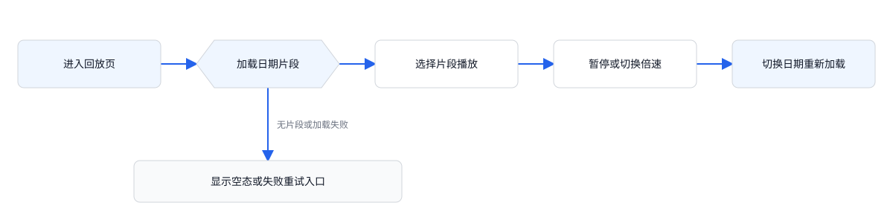

**验收标准：** 片段点击后播放；换日暂停；倍速循环完整；无录像或加载失败时不能播放。

### F11 相册查看与删除

**入口：** 视频直播 → 相册，或截图成功提示 → 进入相册。

**交互规则**

- 相册只展示当前设备的截图、录像；展示总数量，列表按新到旧排列。每项含预览图、类型、时间，录像额外显示秒数。
- 空相册提示“相册还是空的”，引导在直播中截图或录制。离线或隐私不影响已有媒体浏览。
- 点击记录打开详情：截图可看图片，录像可播放保存的视频；关闭详情返回相册。
- 拥有者详情提供“删除此记录”，点击立即删除并关闭详情，更新数量；共享成员没有删除入口。删除最后一项后显示空态。
- 删除失败保留原记录并提示失败；记录已不存在时展示“记录不存在”。

**操作流程**

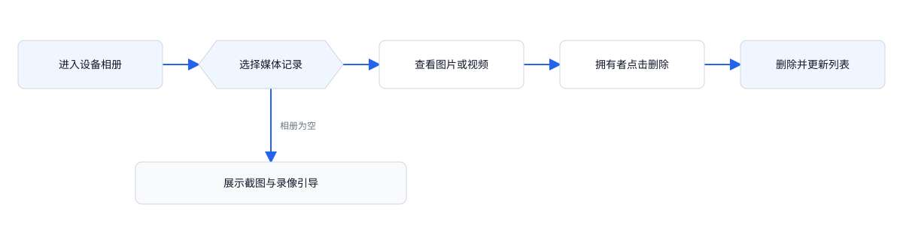

**验收标准：** 截图和录像均可打开；拥有者删除后列表同步减少；共享成员只可查看。

### F12 隐私模式

**入口：** 视频直播 → 隐私模式；或隐私遮罩 → 关闭隐私模式。

**交互规则**

- 仅设备在线的拥有者可修改；共享成员与离线设备禁止修改。按钮显示“已开启 / 已关闭”。
- 点击切换开关，无二次确认；先结束并保存正在录制的视频，再应用隐私状态。
- 开启后停止实时采集、隐藏实时画面，禁用全屏、截图、录像与画质；关闭后恢复直播。
- 隐私开关按设备生效，已有相册、本地录像、云录像、历史分析保持可查看；停止新增视频和相应分析数据，历史结果保留原生成时间。温湿度采集和外设控制不受视频隐私模式影响。
- 设备执行成功后更新开关；失败保持原状态并显示失败提示。

**操作流程**

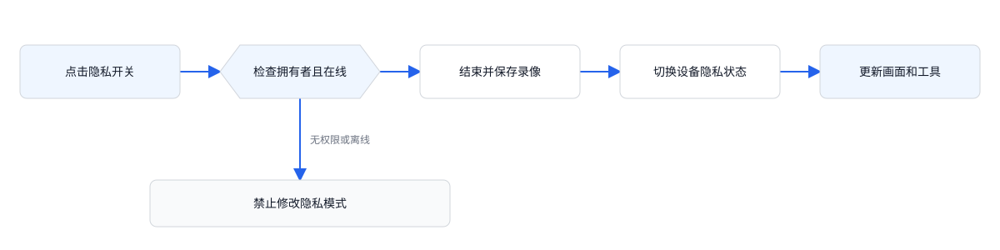

**验收标准：** 开启隐私不丢失手动录像；遮罩和按钮一致；共享成员不能关闭隐私。

## 4. 智能养护功能

### F13 智能养护总览与数据状态

**入口：** 摄像头 → 智能养护。

**交互规则**

- 优先检查关联宠物。未关联时仅显示“先关联你的爬宠”，说明直播和回放可正常使用；拥有者可关联，共享成员不可操作。
- 已关联时，按当前设备、当前关联宠物、当天日期读取报告。总览分为“今日状态”和“健康评估”。
- 今日状态依次包含饮食分析、活动分析及九宫格、蜕皮检测、AI 状态解读；健康评估依次包含 AI 多维健康分析、异常疾病风险识别、AI 健康解读。
- 进食、饮水、活动、区域、蜕皮、健康、风险分别判断可用性。缺失或生成中显示“数据不足”与“—”，不使用 0 或正常状态代替。
- 饮食详情在进食或饮水至少一项可用时开放；活动、蜕皮、健康详情分别在本项可用时开放。某一项数据不足不影响其他项展示。
- 设备离线或开启隐私后，已生成的结果仍可查看；当天无数据时显示“数据不足”。

**操作流程**

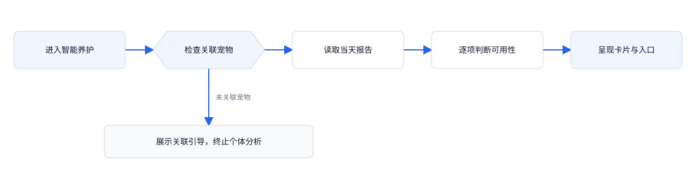

**验收标准：** 未关联优先出现关联引导；部分结果可用时仅相应入口开放。

### F14 饮食分析与详情

**入口：** 智能养护 → 饮食分析 → 查看详情。

**交互规则**

- 总览分别展示最近一次进食、饮水时间；缺失的一项显示“— / 数据不足”。
- 详情包含周日期条、日历、进食与饮水统计、AI 饮食分析、事件记录。统计展示最近一次时间和当日次数。
- 事件展示日期、时间、行为类型、宠物相关描述及缩略图；点击缩略图打开对应事件视频片段。
- 仅一项可用时仍允许进入详情；不可用项不显示次数或对应事件，移除“表现正常”，综合结论显示“记录尚不完整，暂无法形成综合饮食结论”。
- 两项均不足时关闭详情入口；事件、次数、习性与结论始终归属当前报告宠物及所选日期。

**操作流程**

**验收标准：** 进食可用、饮水不足时只显示进食事件，不能出现完整饮食正常结论。

### F15 活动分析与活动区域

**入口：** 智能养护 → 活动分析 → 查看详情。

**交互规则**

- 总览显示当天累计活动时长，按小时与分钟表达；不足显示“—”，0 分钟属于有效统计值。
- 活动区域以九宫格展示相对活跃度并配文字结论；文字说明与当前九宫格数据保持一致。区域数据不足时使用中性九宫格并显示“活动区域数据不足”。
- 活动时长与区域数据相互独立：区域不足不屏蔽已存在的活动时长或活动详情。九宫格为只读展示，不增加区域编辑。
- 活动详情展示周日期条、日历、累计时长、活动次数、AI 活动分析及事件列表；事件缩略图可播放片段。

**操作流程**

**验收标准：** 活动可用且区域不足时仍能查看活动详情，九宫格不显示虚假的热度。

### F16 蜕皮检测与周期记录

**入口：** 智能养护 → 蜕皮检测 → 查看详情。

**交互规则**

- 总览展示蜕皮识别状态与说明；未识别到蜕皮时显示“未蜕皮 / 未检测到蜕皮行为”。数据不足时显示“— / 数据不足，暂无法判断蜕皮状态”。
- 详情包含蜕皮状态、上次蜕皮距今天数、平均周期、下次预计日期、AI 蜕皮分析与历史周期时间线。
- 时间线展示每次开始、完成、持续时间、与相邻周期的间隔，并突出下次预计节点。
- 该详情不提供饮食/活动的周日期条与日历，也不添加事件视频缩略图。数据不足时禁止进入详情。
- 周期数值和解读使用当前宠物的蜕皮记录。无记录时按数据不足处理，不能显示“未蜕皮”。

**操作流程**

**验收标准：** 有数据时可进入周期详情；数据不足时禁用详情入口，并显示不足提示。

### F17 AI 状态解读

**入口：** 智能养护 → 今日状态底部。

**交互规则**

- 进食、饮水、活动三项均可用时显示对当前宠物的综合状态说明与日常观察建议。
- 任意一项不足时显示“进食、饮水或活动记录不足，暂无法形成完整的综合结论。”，不能沿用完整状态结论。
- 该模块只读，无独立详情入口。切换设备后更新宠物名称及解读内容。

**操作流程**

**验收标准：** 仅活动可用也不能输出三项完整综合结论；切换设备后不沿用原宠物名字。

### F18 多维健康分析与健康报告

**入口：** 智能养护 → AI 多维健康分析 → 查看健康报告。

**交互规则**

- 总览展示健康等级、分数与状态说明；可用时开放“查看健康报告”，不足时显示“数据不足 / —”并禁用入口。
- 详情展示综合评分、较昨日变化、近 7 日趋势、疾病风险识别及健康维度。
- 健康维度分为三项：活力指数（活动时长、活动频次、昼夜规律）；进食规律（进食频次、进食间隔、进食稳定）；体态健康（体表健康、姿态健康、健康稳定）。每项展示维度分及三个参数评分。
- 健康可用但风险不足时，健康详情继续展示评分与维度，仅风险区域显示“数据不足，暂无法判断风险”。
- 健康报告没有单独日期选择器，沿用进入时的报告。

**操作流程**

**验收标准：** 健康可用而风险不足时可进入详情，风险区域不显示正常结论。

### F19 异常疾病风险识别与 AI 健康解读

**入口：** 智能养护 → 健康评估区域及健康报告。

**交互规则**

- 风险数据可用时展示识别结果和观察建议；无明显风险时显示“暂未识别到明显风险”。风险不足时显示不足，不展示正常状态图标。
- 健康报告风险部分展示外伤、皮肤溃烂两类识别项及各自结果，并保留“识别结果仅供参考，不代表专业医学诊断”。
- AI 健康解读只有健康与风险均可用时才输出完整结论；任意一项不足则显示“健康或风险识别数据不足，暂无法生成完整健康解读。”
- 总览中的风险结果和 AI 解读只读，无独立操作入口。

**操作流程**

**验收标准：** 风险缺失时不展示“未识别到风险”；仅有健康分数时，不生成完整健康解读。

### F20 饮食 / 活动详情日期切换

**入口：** 饮食或活动详情 → 周日期条或日历。

**交互规则**

- 默认选择进入时报告日期，周日期条按周一至周日展示该日期所在周，日历可跨周选择。
- 仅允许当天及过去日期，未来日期禁用；切换后保留当前分析类型，滚动回顶部并重新读取报告。
- 查询必须同时匹配设备、报告所属宠物、所选日期。更换关联宠物不改写历史报告的宠物归属。
- 无当日报告显示“当天暂无报告 / 当前日期数据不足，可选择其他日期”，保留日期条以便继续选择。

**操作流程**

**验收标准：** 可跨周选历史日期；未来不可选；无报告后可切回有报告日期恢复内容。

### F21 行为事件视频片段

**入口：** 饮食或活动详情 → 事件缩略图播放按钮。

**交互规则**

- 打开事件视频弹层并从 0 秒自动播放；弹层绑定事件标题、宠物、日期、时间及设备。
- 提供暂停 / 播放、进度拖动、已播 / 总时长和关闭按钮；单个事件片段时长为 15 秒。
- 播放至结尾暂停，按钮变为“重播”；点击重播从 0 秒开始。拖动到末尾同样进入结束状态。
- 关闭弹层停止播放并释放资源，回到原报告和滚动位置。
- 片段加载失败时显示失败提示和重试按钮，播放器保持未播放状态。

**操作流程**

**验收标准：** 自动播放、暂停、拖动、结束重播和关闭均可完成；关闭后不继续计时或播放声音。

## 5. 宠物关联

### F22 关联宠物与新建档案

**入口：** 未关联养护引导，或设备设置 → 关联宠物。

**交互规则**

- 一台摄像头关联一只爬宠，关联弹层展示可选档案；拥有者可选择现有宠物或新建档案，共享成员只读。
- 选择不同宠物后保存关联，设备分析状态切为数据不足；新的分析使用新宠物档案，历史报告保留生成时宠物。
- 新建档案包含宠物名字、物种，均必填且去除首尾空格；名字最多 20 字符，物种最多 30 字符。
- 从关联弹层新建并保存后直接关联新宠物，关闭弹层并刷新页面；选择当前已关联宠物时，保留现有分析状态。

**操作流程**

**验收标准：** 切换宠物后不会显示旧宠物当天结论；历史报告归属不变；空白字段不能保存。

## 6. 智慧中控

智慧中控位于摄像头主页顶部切换栏，与视频直播、智能养护同级。页面包含环境监测和外设控制两个模块。

### 6.1 功能范围与页面构成

页面上方保留当前摄像头名称、切换设备及设备设置入口；内容自上而下为环境监测、外设控制。温湿度与外设均属于当前摄像头对应的爬宠箱，不由宠物档案关联决定。

| 模块 | 展示内容 | 操作 |
|---|---|---|
| 环境监测 | 温度、湿度、各自单位、采集时间及有效性 | 只读展示；失败时可重新加载 |
| 外设控制标题 | “外设控制”、当前关联外设数量 | 数量随列表更新，包含已关联但离线的设备 |
| 外设卡片 | 类型图标、名称、状态文字、开关 | 在线拥有者对单个设备执行开启 / 关闭 |

本期支持查看当前温湿度、单独开启或关闭外设。范围外功能：温湿度阈值和告警、历史曲线、定时与自动联动、调光和档位调节、批量开关、外设新增及删除。

### F23 智慧中控入口与加载

**入口：** 摄像头主页顶部切换栏 → 智慧中控。

**交互规则**

- 点击后选中“智慧中控”，保留当前设备并滚动至内容顶部；正在直播录像时先按 F06 保存，再切换栏目。
- 同时读取当前爬宠箱的环境数据、控制链路状态与外设列表，两个模块独立加载，分别显示数据或失败提示，互不影响。
- 页面前台展示时每 10 秒同步一次温湿度及外设状态；上一次请求未完成时跳过本轮请求。进入栏目、重新回到前台、切换设备后首次进入时立即读取。
- 离开栏目或进入后台停止周期同步。重新进入先获取最新状态；旧请求返回仅能更新其所属设备，不能覆盖当前新设备。
- 未关联宠物不限制此功能。开启视频隐私后，环境监测和外设保持原状态。外设控制需满足拥有者权限、控制链路在线、外设在线三个条件。
- 无当前设备访问权限时显示失效提示并返回来源页；设备不支持环境或外设能力时分别显示“暂无环境数据”或“暂无关联外设”，无数据项显示“—”。

**操作流程**

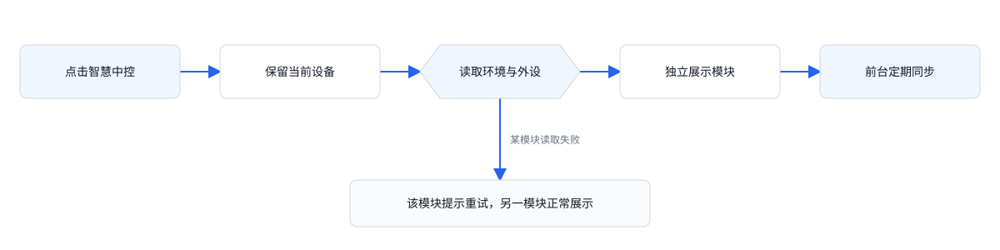

**验收标准：** 三栏目同级可切换；温湿度与外设归属当前设备；单个模块失败不影响另一模块；离开栏目后停止定时请求。

### F24 温湿度展示与更新

**入口：** 智慧中控 → 环境监测。

**交互规则**

- 并列展示“温度”“湿度”两项。温度单位为 °C，湿度单位为 %，使用设备返回值，保留至多 1 位小数并省略无意义的末尾 0。
- 温湿度按传感器实测值显示，支持负温度和有效的 0 值。无效值或传感器报错时显示异常，不填默认值。
- 两项分别判断可用性：首次加载显示加载态；无采集记录显示“— / 暂无数据”；读取失败且无历史记录显示“— / 读取失败”并提供重试。
- 有已采集值但设备离线、传感器异常或本轮读取失败时保留最后值，同时明确标注“历史数据”、采集时间及当前异常原因；恢复读取后再更新为有效状态。
- 正常展示最近有效数据及更新时间；服务返回数据已失效时，即使请求成功，也按历史数据展示。温度和湿度分别处理，一项失效时保留另一项有效数据。
- 页面定期同步与手动重试成功后，更新对应值、采集时间并移除已解除的异常标识。温湿度展示不触发任何自动开关动作。

**操作流程**

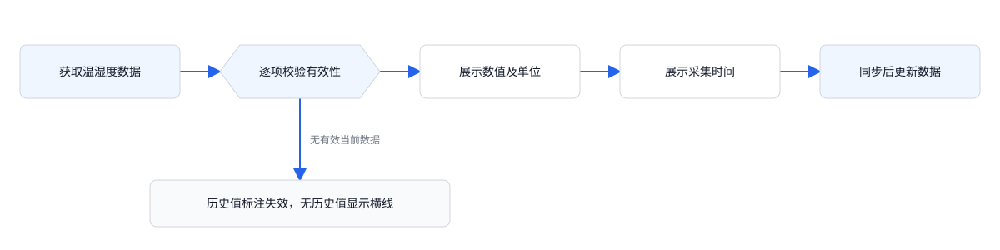

**验收标准：** 数值、单位、时间和有效性正确；单项缺失不影响另一项；读取失败时显示异常提示，不填默认值。

### F25 外设列表与状态展示

**入口：** 智慧中控 → 外设控制。

**交互规则**

- 列表展示当前爬宠箱已关联的外设，标题显示“N 个设备”，N 取关联外设数量。支持的类型及展示顺序见下表。
- 每张卡片展示类型图标、设备名称、状态文字和独立开关。按类型表顺序展示，同类型多个外设分别成卡并显示各自名称，不合并控制。
- “已开启”对应开关选中，“已关闭”对应关闭；文字和开关均以设备确认的状态为准。
- 外设离线时显示“设备离线”，开关禁用；尚未取得有效状态时显示“状态待同步”，开关禁用。外设控制链路离线时全部开关禁用。
- 共享成员能查看外设状态但开关只读；拥有者在设备在线、状态已知、没有处理中的指令时可操作。
- 无关联外设时显示“0 个设备 / 暂无关联外设”；列表读取失败时显示“外设加载失败”与重试按钮，保留失败状态。
- 部分外设离线不影响其他在线外设；其他客户端改变开关后，本页下一次同步更新实际状态。

| 顺序 | 外设类型 | 控制动作 |
|---|---|---|
| 1 | 照明灯 | 开启 / 关闭 |
| 2 | UV 灯 | 开启 / 关闭 |
| 3 | 加热垫 | 开启 / 关闭 |
| 4 | 风扇 | 开启 / 关闭 |
| 5 | 喷雾 | 开启 / 关闭 |
| 6 | 滴水器 | 开启 / 关闭 |

**操作流程**

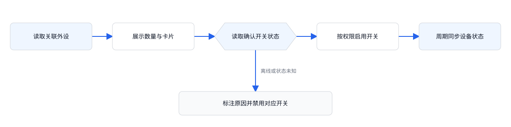

**验收标准：** 数量等于实际卡片数；每台外设的文字和开关状态一致；未知状态不显示为已关闭；六类外设权限一致。

### F26 单外设开关与结果反馈

**入口：** 点击对应外设卡片上的开关。

**交互规则**

- 点击已关闭设备即请求“开启”，点击已开启设备即请求“关闭”；操作仅作用于这一个外设，无二次确认，不关联其他设备。
- 提交前校验拥有者权限、当前设备归属、控制链路与外设在线状态、开关状态已知、无未完成指令；任何条件不满足则不发出指令，并显示对应原因。
- 指令参数使用目标状态“开”或“关”。该卡片显示“正在开启…”或“正在关闭…”，禁用重复点击，其他可操作设备不受影响。
- 只有设备确认达到目标状态后才显示“已开启 / 已关闭”并给出成功反馈。服务受理后继续等待设备确认，普通状态刷新不结束指令等待。
- 明确执行失败时提示“开启失败”或“关闭失败”并重新读取实际状态；读取成功后恢复实际开关和可操作状态。未读到实际状态则显示待同步并保持禁用。
- 提交后 10 秒仍未确认结果，展示“操作超时，正在同步设备状态”，重新读取实际状态；超时后保持待同步状态，不回退开关或重发指令。获取确认状态后再允许下一次操作。
- 等待期间断网或设备离线时提示原因，转为状态待同步；恢复连接后读取实际结果。状态持续未知时提供“重新同步”入口，重试仅查询状态，不重复下发开关指令。
- 切换栏目或设备不撤销已发送指令；返回原设备时重新读取实际状态。后续响应按设备及指令标识处理，只更新对应设备状态。

**操作流程**

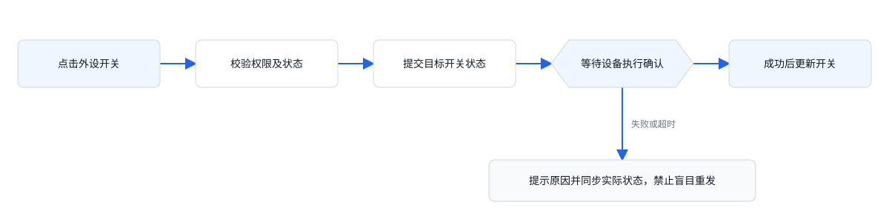

**验收标准：** 六类外设均能独立开启和关闭；处理中不可重复提交；失败或超时显示对应提示；切换设备后状态归属正确，指令只发送一次。

## 7. 验收场景

每项功能按 F01—F26 单独验收，并覆盖以下组合场景。

| 编号 | 场景与操作 | 预期结果 |
|---|---|---|
| T01 | 正常多设备，从 A 切换 B | 默认展示 B 的视频直播，画面、宠物与相册全部归 B |
| T02 | 未关联宠物进入养护 | 显示关联引导；直播和回放不受关联状态影响 |
| T03 | 未关联宠物且无历史报告 | 优先显示关联引导，不直接显示个体分析 |
| T04 | 已关联宠物但当天数据不足 | 养护展示数据不足；云回放入口可用；本地回放可用 |
| T05 | 离线进入直播 | 离线与最后在线时间可见，实时工具不可用；已有云录像可查看 |
| T06 | 隐私开启 | 直播遮罩且工具禁用；在线拥有者可关闭；相册与已有报告可看 |
| T07 | 离线且隐私开启 | 显示隐私遮罩；关闭隐私不可操作 |
| T08 | 数据全部不足 | 各指标显示“— / 数据不足”，详情不可点，AI 不生成完整结论 |
| T09 | 进食、活动可用，其余不足 | 饮食 / 活动详情可点；饮水事件隐藏；区域中性；蜕皮与健康不可点 |
| T10 | 健康可用、风险不足 | 健康详情可看；风险仅显示不足；AI 健康解读不输出完整结论 |
| T11 | 录制期间切换栏目 / 设备 / 返回 | 自动保存至开始录制设备相册，结束录制状态 |
| T12 | 本地无存储卡 | 显示无卡提示，不进入可播放态 |
| T13 | 回放日期无录像 | 展示所选日期及无录像提示，播放和倍速禁用 |
| T14 | 回放加载失败并重试 | 保留来源与日期；成功恢复，失败继续可重试 |
| T15 | 共享成员进入全部页面 | 可查看允许内容；截图、录像、画质、隐私、删除、关联及外设开关受限 |
| T16 | 饮食 / 活动选择无报告日期再切回 | 无数据不显示旧报告；切回恢复正确日期及宠物内容 |
| T17 | 事件片段播放至结束再重播 | 末尾暂停并显示重播，从 0 秒重新开始；关闭后停止播放 |
| T18 | 替换关联宠物 | 新分析显示数据不足；旧报告的宠物身份不变 |
| T19 | A 设备已关联宠物，B 未关联 | A 获取分析结果或不足态；B 仅展示关联引导 |
| T20 | 删除相册最后一项 | 详情关闭，数量为 0，展示空相册引导 |
| T21 | 视频直播录制中切换智慧中控 | 保存原设备录像，进入同一设备智慧中控；顶部三个栏目同级 |
| T22 | 正常进入智慧中控 | 温度以 °C、湿度以 % 展示；外设数量与列表一致，状态文字与开关一致 |
| T23 | 温度有效、湿度未读取 | 温度正常展示；湿度显示“— / 暂无数据”，不填 0% 或 60% |
| T24 | 设备离线或环境读取失败 | 历史值标注失效及采集时间，无历史值显示“—”；控制链路离线时禁用外设，单独环境读取失败不影响在线外设操作 |
| T25 | 开启或关闭任一外设并成功 | 该卡片进入处理中，确认成功后更新开关及文字；其他外设不变化 |
| T26 | 外设指令明确失败 / 超时 | 明确失败提示失败并同步实际状态；超时显示待同步且禁用，不显示成功状态 |
| T27 | 共享成员进入智慧中控 | 可看温湿度及外设状态，全部外设开关只读 |
| T28 | 未关联宠物或隐私开启 | 控制链路在线且有权限时，仍可查看环境与控制外设 |
| T29 | 无关联外设 / 部分外设离线 | 无外设显示 0 个设备及空态；单个离线只禁用该外设，不阻断其他在线外设 |
| T30 | 提交 A 的控制指令后切换 B | B 不显示 A 的处理中或结果；返回 A 重新读取实际状态，不重复发出指令 |
| T31 | 同一外设连续点击 / 其他客户端改变状态 | 处理中禁止重复点击；重新同步后按最新设备确认状态展示 |
| T32 | 页面切到后台后再次进入 | 后台停止周期刷新；返回时立即读取环境与外设状态，读取前不允许未知状态控制 |
